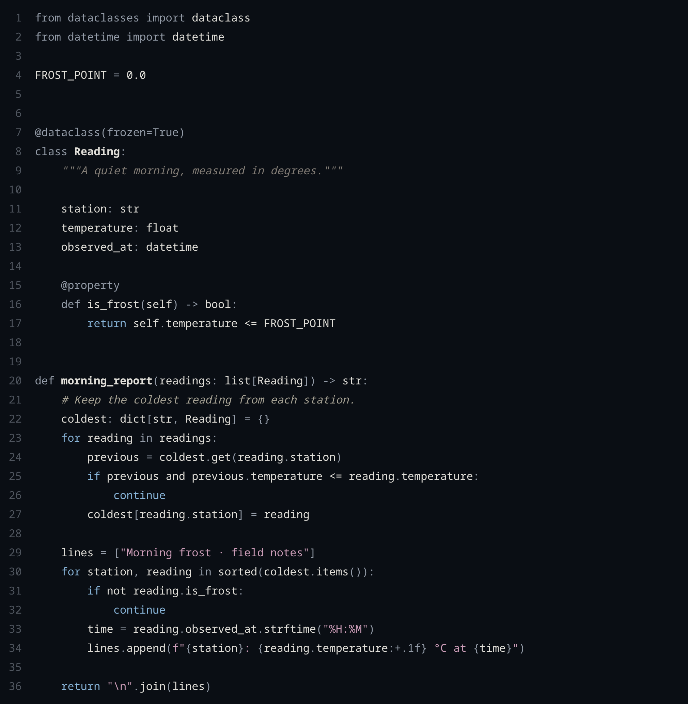
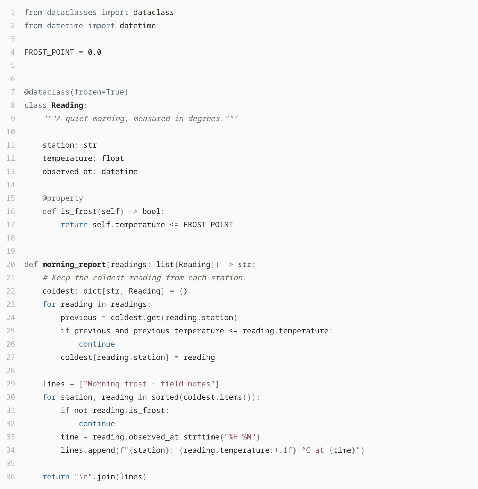
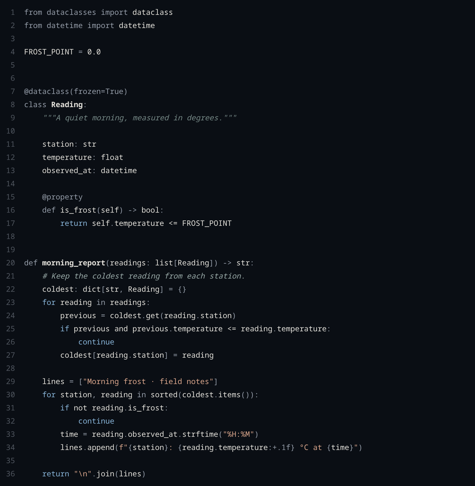
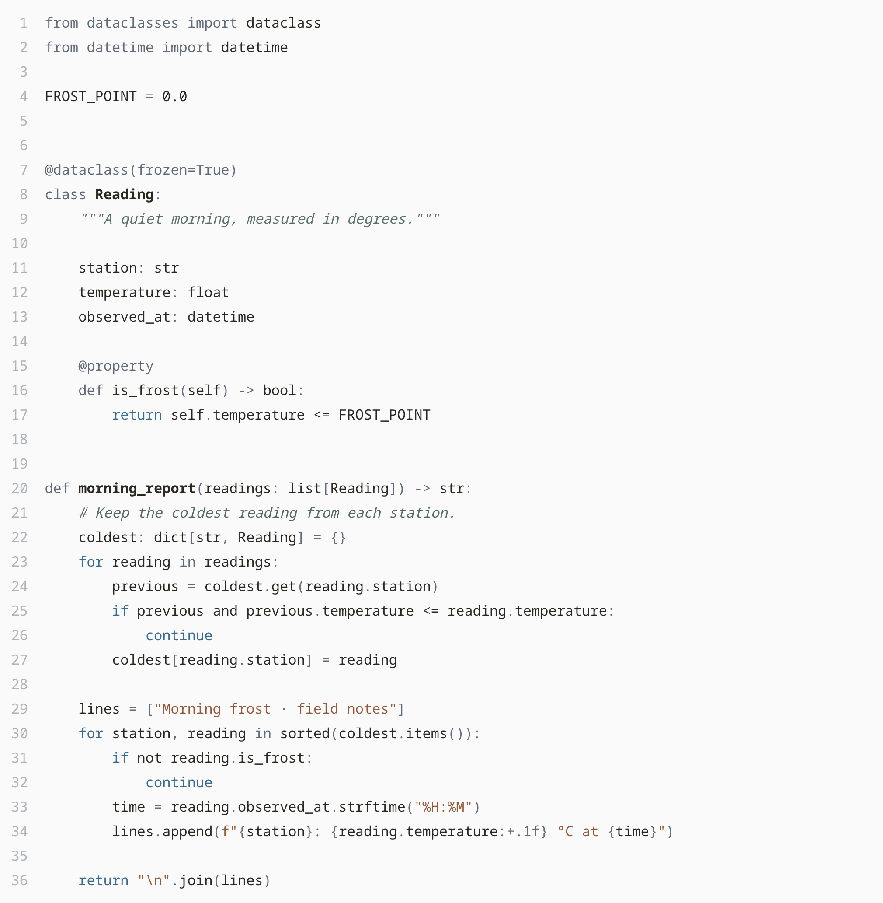
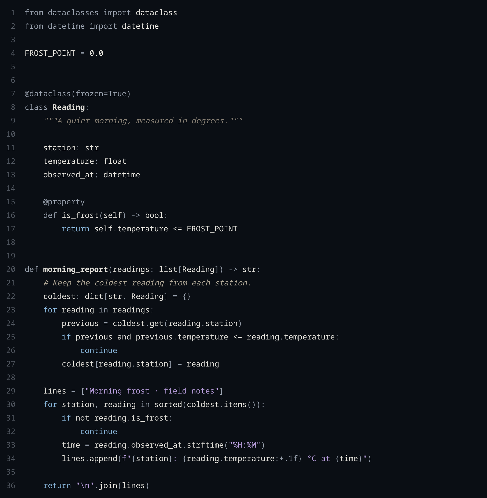
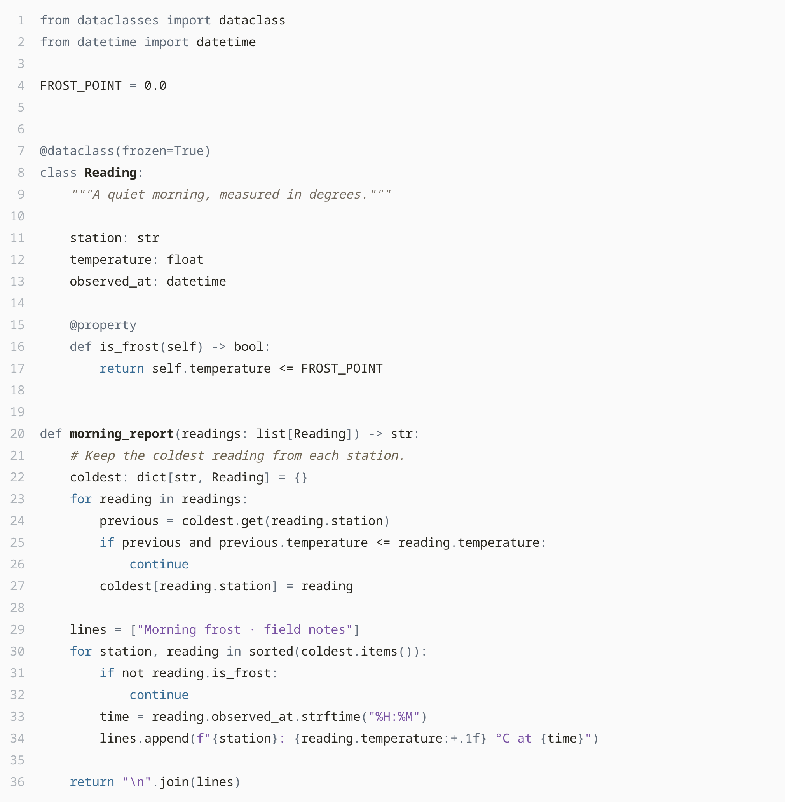
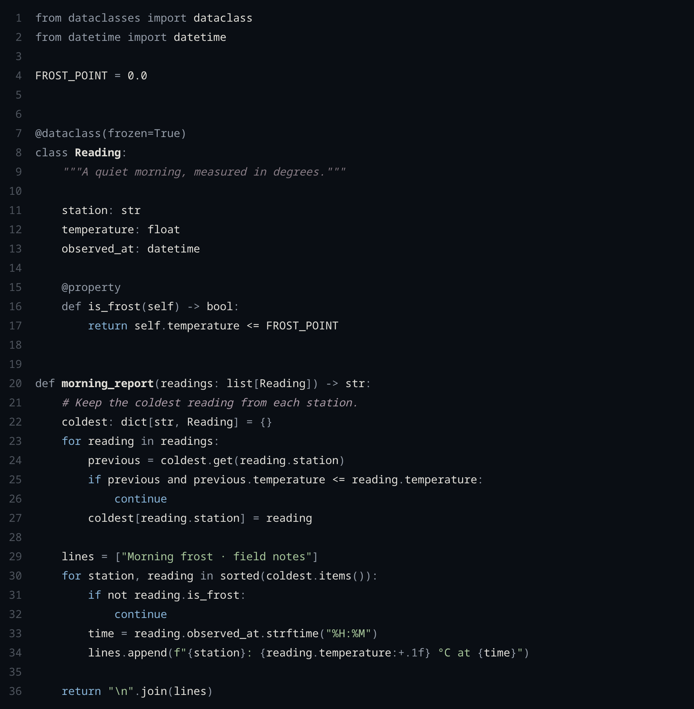
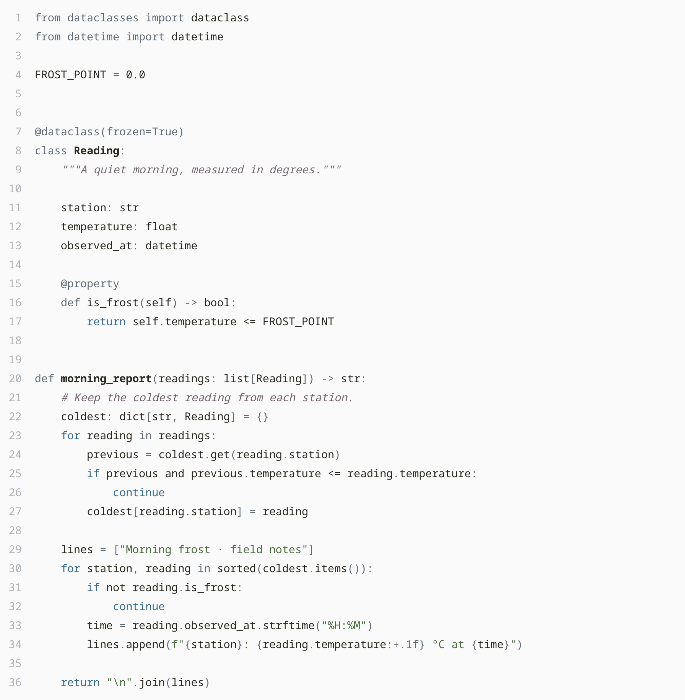

<p align="center">
  
</p>

<h1 align="center">Eenei</h1>

Frost-blue themes for Visual Studio Code, with four flower palettes in Dark and Light.
The name comes from Russian «иней» (frost), pronounced **EE-nyey** /ˈinʲɪj/.

Control flow uses a shared blue. Strings and comments have colors chosen for each
palette. Names and values stay quiet; highlighting works as soon as you select a theme.

[Palettes](#palettes) · [Previews](#previews) · [Customization](#customization) · [Development](docs/development.md)

## Install

1. Find **Eenei** by **AndreyGatsuk** in Extensions (`AndreyGatsuk.eenei`), or
   install `eenei.vsix` with **Extensions: Install from VSIX…**.
2. Open **Preferences: Color Theme** (`Ctrl+K Ctrl+T` / `⌘K ⌘T`).
3. Choose **Eenei on Rose**, **Dahlia**, **Lilac** or **Hellebore**, in Dark or Light.

For a local build, run `npm ci && npm run package`; the file is `dist/eenei.vsix`.

## Palettes

<!-- palettes:start -->
| Palette | Dark | Light |
| --- | --- | --- |
| **Eenei on Rose** |  |  |
| **Eenei on Dahlia** |  |  |
| **Eenei on Lilac** |  |  |
| **Eenei on Hellebore** |  |  |

Swatches: background · surface · frost blue · strings · comments · documentation.

<details>
<summary>Eenei on Rose — color values</summary>

| Role | Dark HEX | Light HEX |
| --- | --- | --- |
| Background | `#0A0E14` | `#FAFAFA` |
| Surface | `#101720` | `#F0F2F4` |
| Raised surface | `#151F2A` | `#FFFFFF` |
| Border | `#273442` | `#D8DDE3` |
| Text | `#E0DED8` | `#292720` |
| Frost blue | `#88B4D8` | `#376B93` |
| Strings | `#CC9DB8` | `#925471` |
| Comments | `#A6A294` | `#686354` |
| Documentation | `#847E77` | `#70695F` |
| Scaffolding | `#949CA8` | `#606B78` |

</details>

<details>
<summary>Eenei on Dahlia — color values</summary>

| Role | Dark HEX | Light HEX |
| --- | --- | --- |
| Background | `#0A0E14` | `#FAFAFA` |
| Surface | `#101720` | `#F0F2F4` |
| Raised surface | `#151F2A` | `#FFFFFF` |
| Border | `#273442` | `#D8DDE3` |
| Text | `#E0DED8` | `#292720` |
| Frost blue | `#88B4D8` | `#376B93` |
| Strings | `#D8A58B` | `#935939` |
| Comments | `#99AAA8` | `#546967` |
| Documentation | `#768987` | `#5C706E` |
| Scaffolding | `#949CA8` | `#606B78` |

</details>

<details>
<summary>Eenei on Lilac — color values</summary>

| Role | Dark HEX | Light HEX |
| --- | --- | --- |
| Background | `#0A0E14` | `#FAFAFA` |
| Surface | `#101720` | `#F0F2F4` |
| Raised surface | `#151F2A` | `#FFFFFF` |
| Border | `#273442` | `#D8DDE3` |
| Text | `#E0DED8` | `#292720` |
| Frost blue | `#88B4D8` | `#376B93` |
| Strings | `#B59BD8` | `#7952A3` |
| Comments | `#AAA292` | `#6E6451` |
| Documentation | `#867E73` | `#736B60` |
| Scaffolding | `#949CA8` | `#606B78` |

</details>

<details>
<summary>Eenei on Hellebore — color values</summary>

| Role | Dark HEX | Light HEX |
| --- | --- | --- |
| Background | `#0A0E14` | `#FAFAFA` |
| Surface | `#101720` | `#F0F2F4` |
| Raised surface | `#151F2A` | `#FFFFFF` |
| Border | `#273442` | `#D8DDE3` |
| Text | `#E0DED8` | `#292720` |
| Frost blue | `#88B4D8` | `#376B93` |
| Strings | `#A8C79B` | `#486C3C` |
| Comments | `#AD9DA9` | `#75616E` |
| Documentation | `#887C85` | `#786A74` |
| Scaffolding | `#949CA8` | `#606B78` |

</details>
<!-- palettes:end -->

## Previews

<details>
<summary>Compare all four palettes on the same code</summary>

| Dark                                                                     | Light                                                                      |
| ------------------------------------------------------------------------ | -------------------------------------------------------------------------- |
|            |            |
|        |        |
|          |          |
|  |  |

</details>

## Customization

Eenei works out of the box. For personal adjustments, open
**Preferences: Open User Settings (JSON)** and merge the overrides you want into
your settings. For example, give Rose Dark a rose-colored cursor, active tab
border and links:

```json
{
  "workbench.colorCustomizations": {
    "[Eenei on Rose Dark]": {
      "editorCursor.foreground": "#CC9DB8",
      "tab.activeBorder": "#CC9DB8",
      "textLink.foreground": "#CC9DB8",
      "textLink.activeForeground": "#CC9DB8"
    }
  }
}
```

The override applies only to the named theme. Replace the name and HEX values to
customize another variant; remove the override to restore the defaults.

You can also [adjust comment colors](docs/customization.md#adjust-comment-colors)
or [remove comment italics](docs/customization.md#remove-comment-italics).
The [customization guide](docs/customization.md) includes the full examples and
scope details. These use VS Code's built-in settings.

## Language support

Standard VS Code grammars are supported alongside bundled syntax for Vue, Svelte,
Astro, MDX, GraphQL, Jinja, TOML, Zig, Nix and others. Additional language tools are
optional for completion and formatting. See [language support](docs/languages.md)
and the [coverage guide](docs/coverage.md) for tested scope and limits.

## Development

Sources are in `src/`, tooling in `scripts/`, and the installable extension in
`vscode/`. See [development](docs/development.md) and [design](DESIGN.md).

Inspired by [Navigate](https://github.com/skatromb/navigate-theme) and
[Pustota](https://github.com/pustota-theme/pustota).
[MIT license](LICENSE).
